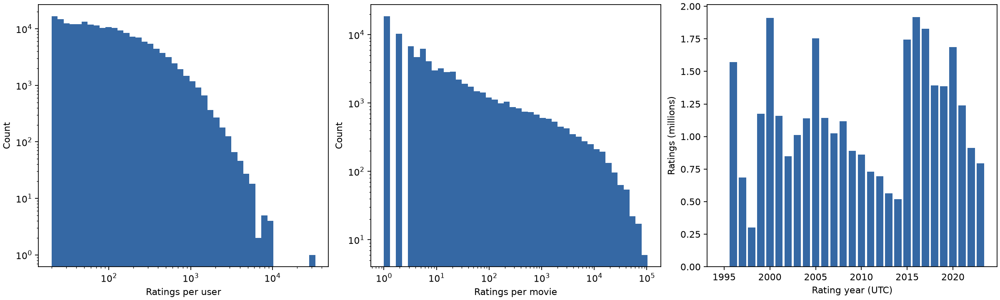

# 数据质量与描述性统计报告

数据：官方完整MovieLens 32M，2023-10-13生成版本。检查日期：2026-10-14，Asia/Hong_Kong。四张CSV为UTF-8，ZIP CRC通过、四表MD5与官方README一致，SHA-256见[原始清单](../data/raw_manifest.json)。

| 表 | 行数 | 必需字段null | 完全重复行 | 主键 |
| --- | ---: | ---: | ---: | --- |
| ratings | 32,000,204 | 0 | 0 | userId+movieId唯一 |
| movies | 87,585 | 0 | 0 | movieId唯一 |
| tags | 2,000,072 | 0 | 0 | 事件表，无单独主键，不将用户电影对设为唯一 |
| links | 87,585 | 0 | 0 | movieId唯一，可选tmdbId有124个null |

ratings和tags的movieId均存在于movies；tags用户均存在于ratings；links与movies编号一一对应。评分全部在0.5到5.0且为0.5步长，ID和时间戳合法。评分原始表无修改或删行。

6条标签只有空白内容；tags_clean.parquet去除这些事件，并对6,392条标签去首尾空白，保留2,000,066条事件。links_checked.parquet保留全部记录和缺失的可选tmdbId，不补造编号。热门基线不使用标签和外部链接，处理不影响评分划分或基线结果。未来标签特征必须在推荐时刻前过滤事件。

| 分布 | 最小 | p50 | p90 | p99 | 最大 | 均值 |
| --- | ---: | ---: | ---: | ---: | ---: | ---: |
| 每用户评分数 | 20 | 73 | 364 | 1,290 | 33,332 | 159.246 |
| 每电影评分数，包括零评分 | 0 | 5 | 230 | 8,877.8 | 102,929 | 365.362 |

用户200,948、电影87,585，评分密度0.181819%；3,153部电影无评分但在电影目录中。评分从1995年延续到2023年，准确UTC时间、各年记录数和评分直方图见[统计JSON](descriptive_statistics.json)。用户活跃度和电影热度有明显长尾，应在后续阶段保留冷热物品分组分析。

逐用户划分为训练25,520,897条、验证3,188,339条、测试3,290,968条。按floor(0.8n)、floor(0.9n)舍入，因此总体百分比不精确等于80/10/10。35,119位用户训练/验证边界时间相同，32,555位用户验证/测试边界时间相同；原始行号稳定排序，热门度特征只纳入严格早于推荐时刻的训练事件。没有训练晚于验证或验证晚于测试的用户。

评分主数据与编号关系通过本地输入验收；可选编号缺失和空白标签已报告并生成派生处理。原始数据并非所有字段零缺失。教师统一程序一致性待核验。
