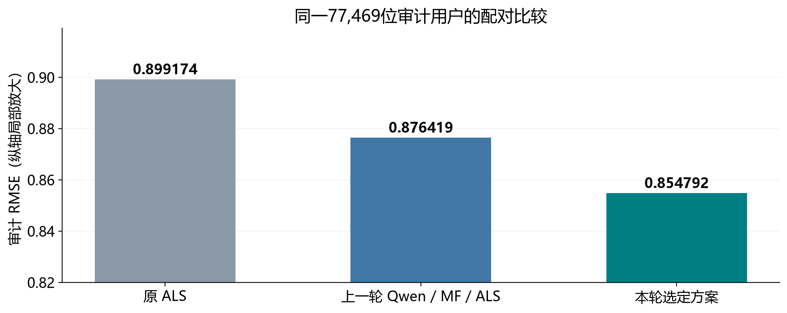
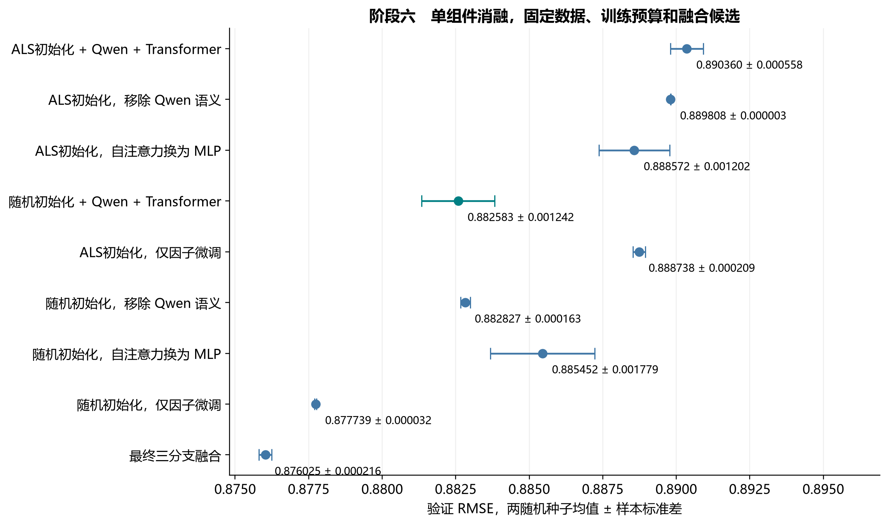

# 阶段六 系统集成、消融与最终评分预测

本项目已切换为使用用户提供的 MovieLens/合成混合评分数据，最终任务是预测 `test_pairs.csv` 的评分并按 RMSE 评价。旧六阶段中的 NDCG、召回和 Top10 结果仍是此前官方 MovieLens 32M 实验，属于历史记录，不能作为混合数据上的结果。

## 本轮方案：候选历史记忆与五折残差校正

本轮预留的77,469位审计用户上，上一轮融合 **0.876419 → 0.854792**，相对降低 **2.468%**；原ALS在相同审计用户上为0.899174。开发OOF为0.856428，外层留出合并OOF/审计为0.856101。后者含第二层开发监督，不能直接当作与旧0.875872完全相同训练协议的独立测试比较。

采用近期候选条件记忆思想的评分回归改编，结合时间MF、截断SVD++、历史统计和CatBoost残差校正。根据开发集选择57特征方案，移除额外语义特征反而更好。没有完整复现工业TransX/LWR，也不宣称全球SOTA。固定方案后才打开本轮审计；旧项目曾用全体外层留出调参，所以仍需全新隐藏测试。



新预测在本地 `data/raw/hybrid/test_pairs_predictions_advanced.csv`。训练数据、依赖与模型仍在D盘；没有阶段七。[方法与复现边界](../docs/advanced_method.md)、[正式实测与消融](logs/advanced/experiment_2026-11-23.md)、[全部同人群指标](logs/advanced/advanced_comparison.csv)、[独立核验](logs/advanced/verification.json)。测试无标签，没有测试RMSE。

### 本轮复现入口

先完成上一轮数据与基础分支准备。所有命令在仓库根目录执行，先设置D盘缓存环境变量（见下文依赖段），使用共享环境。

```powershell
uv pip install --python ..\.venv\Scripts\python.exe -r requirements-advanced.txt
..\.venv\Scripts\python.exe 06_integration_ablation/scripts/prepare_temporal_history.py
..\.venv\Scripts\python.exe 06_integration_ablation/scripts/prepare_temporal_history.py --full
..\.venv\Scripts\python.exe run_advanced.py --trials
..\.venv\Scripts\python.exe 06_integration_ablation/scripts/prepare_rating_features.py
..\.venv\Scripts\python.exe 06_integration_ablation/scripts/calibrate_advanced.py --name calibration_v2_d6 --depth 6 --iterations 700
..\.venv\Scripts\python.exe 06_integration_ablation/scripts/calibrate_advanced.py --name calibration_v2_d8 --depth 8 --iterations 1200
..\.venv\Scripts\python.exe run_advanced.py --calibration-ablations
```

`freeze_advanced.py`只允许在新实验目录冻结一次，已有冻结结果会拒绝重开，避免按审计调参。新一次复现应先保留原产物、使用新工作副本。

```powershell
..\.venv\Scripts\python.exe 06_integration_ablation/scripts/freeze_advanced.py --candidates calibration_v2_d6 calibration_v2_d8 calibration_v2_d8_no_semantics --ablations calibration_v2_d8_no_history calibration_v2_d8_no_neural calibration_v2_d8_seed2 mf64_r003 mf64_r03 mf64_r08 mf128_r04 svdpp32_r03 memory32_time_r03 memory32_notime_r03 mf64_time_r03
..\.venv\Scripts\python.exe run_advanced.py --refit mf64_r003 mf64_r03 mf64_r08 mf128_r04 svdpp32_r03 memory32_time_r03 memory32_notime_r03 mf64_time_r03
..\.venv\Scripts\python.exe 06_integration_ablation/scripts/prepare_rating_features.py --full
..\.venv\Scripts\python.exe 06_integration_ablation/scripts/predict_advanced.py
..\.venv\Scripts\python.exe 06_integration_ablation/scripts/test_advanced.py
..\.venv\Scripts\python.exe 06_integration_ablation/scripts/verify_advanced.py
..\.venv\Scripts\python.exe docs/create_advanced_figures.py
..\.venv\Scripts\python.exe docs/summarize_advanced.py
```

## 上一轮归档：冻结 Qwen3 语义、Transformer、MF 与 ALS

2026-11-23完成八种结构、两随机种子的16次全量拟合集训练。每次遍历31,513,222条拟合评分4轮，使用相同的386,982条时间留出评分选轮次和融合权重。最终采用随机初始化Qwen3特征Transformer、随机初始化MF与原ALS，权重为0.25、0.55、0.20。

验证RMSE为 **0.875872445**，较原ALS的0.897474914下降 **2.407%**；两个种子均值为 **0.876024980 ± 0.000215716**（样本标准差）。这些是开发验证结果，未提供独立隐藏测试评分。冻结语义本身的独立收益未得到稳定证明，强MF对照与负结果完整保留。



上一轮预测文件 `data/raw/hybrid/test_pairs_predictions_transformer.csv` 在全量31,900,204条评分上重训后生成，未覆盖旧ALS结果。原始数据、训练缓存与模型权重仅保留本地。核验结果为55项通过，见[`logs/transformer/verification.json`](logs/transformer/verification.json)。

### 依赖与复现

在仓库根目录执行。现有共享环境已经满足依赖时不要同步旧历史锁文件。需要新装CUDA版本PyTorch时先运行第一条安装命令。

```powershell
$env:UV_CACHE_DIR = 'D:\AgentProject2026\.venv\cache\uv'
$env:HF_HOME = 'D:\AgentProject2026\.venv\cache\huggingface'
$env:TEMP = 'D:\AgentProject2026\.venv\tmp'
$env:TMP = $env:TEMP
uv pip install --python ..\.venv\Scripts\python.exe torch==2.8.0 --index-url https://download.pytorch.org/whl/cu128
uv pip install --python ..\.venv\Scripts\python.exe -r requirements-transformer.txt
..\.venv\Scripts\python.exe -X utf8 run_transformer.py --prepare --encode --experiments --extra-ablations --refit
..\.venv\Scripts\python.exe -X utf8 06_integration_ablation/scripts/test_transformer.py
..\.venv\Scripts\python.exe -X utf8 06_integration_ablation/scripts/verify_transformer.py
..\.venv\Scripts\python.exe -X utf8 docs/create_course_figures.py
```

同目录的[`transformer_config.json`](transformer_config.json)、[组件对照](logs/transformer/ablation.csv)、[融合分支消融](logs/transformer/ensemble_ablation.csv)、[选模与预测哈希](logs/transformer/ensemble_selection.json)、[实测记录](logs/transformer/experiment_2026-11-23.md)和[方法说明](../docs/transformer_method.md)给出数据口径、运行条件和结果限制。Java11继续使用共享环境已有的`.venv/jdk11`。

## 2026-11-08 原 ALS 评分预测对照

使用 Spark MLlib 显式评分 ALS 在混合数据上训练。完整方法、RMSE 验证、输出字段与限制见[评分预测实验记录](logs/rating_prediction_experiment_2026-11-08.md)、[评分预测指标](logs/rating_prediction_metrics.json)及[预测脚本](scripts/rating_prediction.py)。

运行时传入用户数据目录，预测 CSV 会写在该目录，不会复制或上传数据：

```powershell
$env:JAVA_HOME = 'D:\AgentProject2026\.venv\jdk11'
$env:PATH = "$env:JAVA_HOME\bin;$env:PATH"
$dataDir = 'data/raw/hybrid'
..\.venv\Scripts\python.exe -X utf8 06_integration_ablation/scripts/rating_prediction.py `
  --data-dir $dataDir
```

时间留出验证 RMSE 为0.897475，优于全局均值基线1.067599；验证选择 rank=16 后在全部31,900,204条训练评分上重训，并输出100,000条预测。`test_pairs.csv` 不含真实评分，因此真实测试集 RMSE 无法由当前文件计算。

## 阶段二、四、五与阶段六 RMSE 对比

以下为2026-11-08归档结果，使用同一份混合数据和同一套386,982条逐用户时间留出评分。当时ALS rank=16最优，旧 `test_pairs_predictions.csv` 采用该模型；当前改进结果见本页上方。

| 模型 | 验证 RMSE |
| --- | ---: |
| 全局均值基线 | 1.067599 |
| 阶段二相似度 | 1.047323 |
| 阶段四流式增量 | 1.005831 |
| 阶段五图传播 | 1.063098 |
| 阶段六 ALS rank=16 | **0.897475** |

可复核的逐阶段指标见[阶段二](../02_similarity_recall/logs/hybrid_rating_metrics.json)、[阶段四](../04_streaming_incremental/logs/hybrid_rating_metrics.json)、[阶段五](../05_graph_recommendation/logs/hybrid_rating_metrics.json)和[对比 CSV](logs/hybrid_rating_comparison.csv)。

## 历史排序融合实验

本阶段使用阶段二 LSH Top10、阶段三 ALS Top10、阶段五 PPR Top10 与阶段四流式混合 Top10 构造去重候选并集，再用等权 reciprocal-rank sum 重排。评估沿用阶段一前5,000位候选用户的测试正样本和100个固定负样本。各组件都是离线Top10列表，结果衡量共同工作集列表融合。

## 复现

```powershell
uv run --python D:/AgentProject2026/.venv/Scripts/python.exe python -X utf8 run_phase6.py
uv run --python D:/AgentProject2026/.venv/Scripts/python.exe python -X utf8 06_integration_ablation/scripts/verify_integration.py
```

消融分别移除流式增量列表、图PPR、LSH，并提供 ALS 单模型参照。详细参数见 [config.json](config.json)，指标表见 [ablation_metrics.csv](logs/ablation_metrics.csv)，独立复算见 [verification.json](logs/verification.json)。各配置 Top10 结果见 [ablation_top10.csv.gz](data/processed/ablation_top10.csv.gz)。

完整融合 NDCG@10=0.906646、Recall@10=0.865408，相对同人群热门基线提升4.62%。候选池均值16.64，正样本候选召回92.19%。五种配置及真实消融见[指标表](logs/ablation_metrics.csv)、[实验记录](logs/experiment_2026-11-08.md)、[独立复算](logs/verification.json)和[消融图](curves/integration_ablation.png)。去除流式增量源后 NDCG@10 为0.908725，比完整融合高0.21%；当前增量列表对本融合配置有轻微负贡献。

本阶段验证候选并集和列表重排，没有部署在线服务。重排P99仅覆盖已准备的列表融合和排序，不含 ALS、PPR、LSH、流式源查询、网络和存储。

课程要求全量 NDCG@10 比阶段一基线至少提升10%。本阶段共同工作集提升4.62%，未达到该目标，也不能代替全体用户验收。
